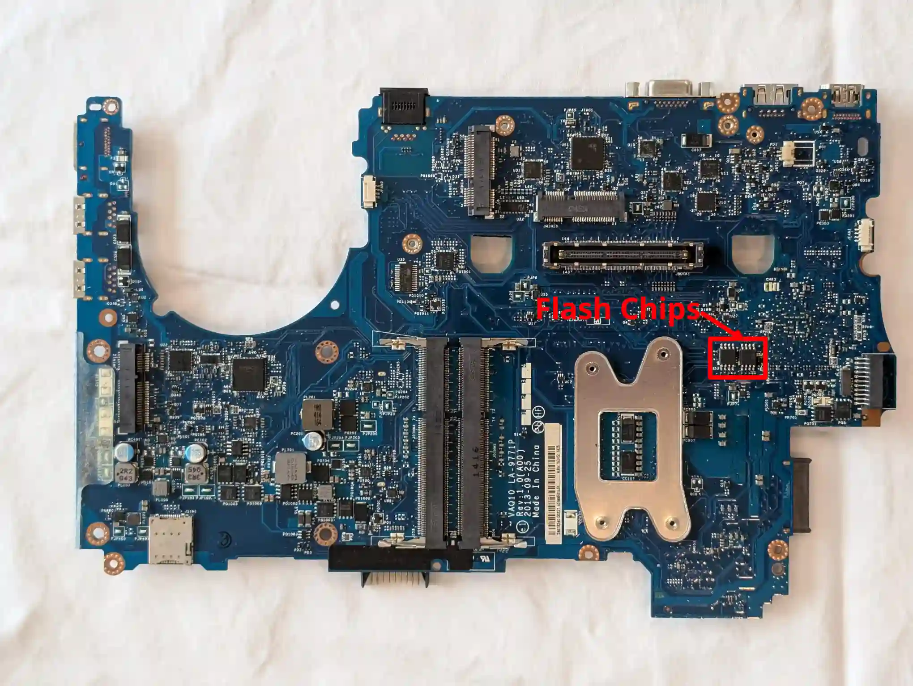

# Dell Precision M4800

This page describes how to run coreboot on the Dell Precision M4800.

The Dell Precision M4800 is a mobile workstation for Intel's fourth gen
Haswell CPUs with a total of four SO-DIMM slots for up to 32GB of DDR3
RAM (16GB for dual-core CPUs) and a MXM type-A slot for discrete GPUs.
The EC is the SMSC MEC5055 which seems to be compatible with the
MEC5035 code.
This port allows booting with any MXM GPUs, including GPUs this board
does not boot on vendor firmware. For NVIDIA on Windows, additional
driver spoofing may be required.

## Required proprietary blobs

The following blobs are required for coreboot on the M4800:

- Intel ME firmware
- (mrc.bin)

If you don't want to use the Haswell Native Ram Init (NRI), you need the
Memory reference code in mrc.bin which is used to initialize the Haswell
platform and required for a working coreboot image. Please see
[mrc.bin](../../northbridge/intel/haswell/mrc.bin) for instructions
on retrieving and using it.

## Programming

Flashing internally is possible with Nicholas Chin's Dell-Flash-Unlock
tool. For instructions, see
<https://github.com/nic3-14159/dell-flash-unlock>.
To flash with an external programmer, you need to fully disassemble the
laptop and remove the motherboard to get access to the flash chips that
are located on its underside.

Once coreboot has been initially deployed, it is possible to update
internally using either Flashrom or UEFI capsule updates.

## Debugging

The board can be debugged with EHCI debug. The EHCI debug ports are at
the rear-most port on right side and the front-most port on left side.

## Test status

Working:
- Haswell CPUs (tested with Intel i7-4800MQ)
- All four SO-DIMM slots (tested with 4x Elpida EBJ81UG8EFU0-GN-F
  8GB SO-DIMMs)
- Keyboard/Touchpad/Trackpoint
- EDK2 payload (MrChromebox's fork, uefipayload_2608)
- dGPU (tested with NVIDIA Quadro K1100M)
- SATA SSD in main drive and in optical bay drive
- Intel Ethernet GbE NIC
- Internal flashing on coreboot with flashrom and UEFI capsule updates
- TPM 1.2
- S3 Suspend and Resume
- All video ports
- Speakers
- 1/2MC (PP) slot (tested with Qualcomm Atheros WiFi card)
- WWAN slot (tested with Qualcomm Atheros WiFi card, mSATA drive
  and Sierra AirPrime DW5570 WWAN card)
- Battery reporting
- Status LEDs
- Lid close event reporting

Not (yet) working:
- Audio headphone jack
- Fan speed reporting and control
- Physical wireless switch
- Brightness control hotkeys

Unknown/Untested:
- ExpressCard
- Micro SD/MMC card reader
- Docking station support (tested on a previous version, most likely
  working)
